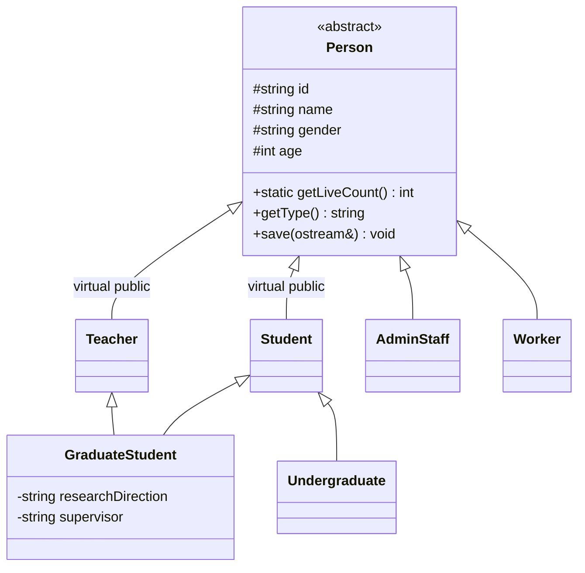

# 学校人员信息管理系统

C++17 学校人员管理作业，使用浏览器界面、C++ HTTP 后端和 SQLite 文件数据库。个人账号、本科生与研究生、课程成绩与排名、研究生多重继承和文件保存均已实现，保留行政人员、普通工作者和控制台程序。

网站：[https://swustmarket.xyz](https://swustmarket.xyz)。发布记录、备份和更新方法见 [部署说明](deploy/README.md)。管理员凭据与实际人员数据库只保存在服务器。

## 使用系统

- 管理员维护五类人员、课程、授课分配、成绩和个人账号，可导出全部业务资料。
- 没有档案的人员在登录页选择“开户”，录入资料并设置密码。已有档案由管理员在“账号管理”开通账号，避免重复编号。
- 个人账号使用工号或学号登录，查看本人档案。教师可以维护管理员分配给自己的课程成绩；本科生与研究生可查看各门课程的本人成绩和名次。
- 研究生还可查看研究方向、导师，以及被分配的授课课程。学生不设置工资，也不计入教职工工资统计。
- 管理员“关闭账号”只停止个人登录，保留档案与成绩；个人“销户”需再次输入密码并确认，会删除本人档案、账号和成绩。
- 每门课只对已录入成绩的本科生和研究生排名。同分并列，如 95、95、88 对应 1、1、3；未录入成绩不参与排名。

个人密码为 8–128 个字符，使用随机盐与 PBKDF2-HMAC-SHA256 保存散列。会话令牌只存散列，有效期最长 8 小时。网页表单登录使用 HttpOnly Cookie；HTTPS 环境增加 Secure、SameSite=Strict。重启后管理员会话失效，个人会话在有效期内保留。

## Windows 本地运行

安装支持 C++17 的 MinGW，确保 gcc、g++ 在 PATH。项目包含 HTTP、JSON、SQLite 源码；加密使用 Windows BCrypt，无需单独数据库服务或 Node.js。

```powershell
.\start_server.bat
```

访问 **http://localhost:8080**，保持终端运行，Ctrl+C 停止。也可用 start_server.ps1。仅编译使用 build_server.bat，再运行 build/server.exe。产物写入 build/。

默认只监听本机，未配置管理员凭据时进入“本机管理员模式”。若要体验完整登录流程，启动前自行设置成对的 SCHOOL_ADMIN_USER 与 SCHOOL_ADMIN_PASSWORD。已有后台服务可先用 stop_server.ps1 停止，脚本会核验进程路径。

| 环境变量 | 默认值 | 用途 |
| --- | --- | --- |
| SCHOOL_HOST | 127.0.0.1 | 监听地址 |
| SCHOOL_PORT | 8080 | HTTP 端口 |
| SCHOOL_DB_PATH | school.db | SQLite 文件 |
| SCHOOL_WEB_ROOT | web | 静态页面目录 |
| SCHOOL_ADMIN_USER | 空 | 管理员账号 |
| SCHOOL_ADMIN_PASSWORD | 空 | 管理员密码 |

相对路径以启动工作目录为准，数据库父目录须存在。首次运行自动建库。服务拒绝在没有管理员凭据时监听非本机地址。公网采用 Nginx HTTPS，C++ 服务只监听回环地址。页面须通过服务访问，不能双击 index.html；不会自动切换到示例数据或 localStorage。

## 类结构与架构



教师和学生虚继承 Person，研究生同时继承 Teacher、Student，最派生构造函数初始化唯一的 Person。Undergraduate 表示本科生，兼容旧 Student 记录。虚函数用于输入、显示、保存；静态原子成员记录活动对象；友元输出运算符用于控制台。Grade::operator< 用于成绩降序及学号稳定排序。

```text
浏览器 index.html / app.js / portal.js / styles.css
                 │ HTTP / JSON / Cookie
                 ▼
C++ web_server / routes / person_codec
                 │
                 ▼
Service 人员校验 + Academy 账号、课程、成绩与文件导出
                 │ 共享连接、锁和事务
                 ▼
Dao + SQLite：people / accounts / sessions / courses / grades
```

Academy 作为 Dao 的友元，在同一事务中开户和保存人员。外键使编号变更同步到账号、会话、课程和成绩；转为非学生时清理其成绩，转为非授课人员时解除课程分配。旧库自动补充字段与表，保留原记录。

## 数据保存

全部业务信息保存在 school.db 文件。管理员导出使用 ofstream 写入 school.db.export.json，再用 ifstream 回读校验，包含人员、账号盐与密码散列、课程及成绩；不包含明文密码、管理员配置密码或会话令牌。JSON 用于资料查阅和文件流演示，**没有 JSON 导入功能**；完整恢复使用 SQLite 备份。

控制台与 Web 复用人员类，数据独立：控制台只维护人员并保存到 school_data.txt；完整账号、课程、成绩功能在 Web 版完成。导出包含账号散列，应作为私有备份保管。

## 主要 API

网页使用 Cookie。原管理员 HTTP Basic API 方式仍兼容，供终端检查。静态网页公开，业务权限由后端验证。

| 方法 | 路径 | 访问范围与用途 |
| --- | --- | --- |
| GET | /api/health | 公开；服务与数据库表健康检查 |
| POST | /api/auth/login、register、logout | 登录、开户、退出 |
| GET | /api/me | 已登录；当前身份及本人资料 |
| POST | /api/auth/password、cancel | 本人；修改密码、确认销户 |
| GET / POST | /api/people | 管理员；人员列表、新增 |
| PUT / DELETE | /api/people/{id} | 管理员；编辑、删除 |
| GET / POST / DELETE | /api/accounts、/api/accounts/{id} | 管理员；开户、关闭账号 |
| GET | /api/courses | 已登录；课程目录 |
| POST / PUT / DELETE | /api/courses、/api/courses/{id} | 管理员；课程及授课分配 |
| GET / POST / DELETE | /api/courses/{id}/grades、/api/courses/{id}/grades/{studentId} | 管理员或该课授课人员；成绩和排名 |
| GET | /api/my/courses | 本人；学生仅返回本人成绩、名次，教师返回授课课程 |
| GET | /api/storage/export | 管理员；全部业务资料文件导出 |

注册请求包含 person 对象与 password；登录包含 username、password。课程包含 id、name、credit、teacherId（可空），成绩包含 studentId、score。成绩 0–100，学分大于 0 且不超过 30，最多两位小数，内部以百分之一单位的整数保存。

| 人员 API 类别 | 专属字段 | 年龄 |
| --- | --- | --- |
| teacher 教师 | department、title、salary | 18–100 |
| admin 行政人员 | department、position、salary | 18–100 |
| student 本科生 | department、major、className、admissionYear | 6–100 |
| graduate 研究生 | 本科生字段及 researchDirection、supervisor | 18–100 |
| worker 普通工作者 | department、job、salary | 18–100 |

公共字段 id、name、gender、age，phone 选填。编号 1–32 位字母、数字、下划线或连字符，全校唯一；学生不提交工资，入学年份 1900–2100。错误状态 400 字段不合法、401 未登录、403 权限或来源不足、404 不存在、409 冲突、415 请求格式、429 登录过多、503 存储故障，返回含 error 的 JSON。

## 构建与验证

Ubuntu 需要 g++、gcc、cmake、make、python3、libssl-dev，加密使用 OpenSSL libcrypto：

```bash
cmake -S . -B build-cmake -DCMAKE_BUILD_TYPE=Release
cmake --build build-cmake -j1
ctest --test-dir build-cmake --output-on-failure
python3 tests/test_api.py --server build-cmake/server
python3 tests/test_academy.py --server build-cmake/server
python3 tests/test_console.py --console build-cmake/school_system
```

Windows 编译后运行 python tests/test_api.py --server build/server.exe、python tests/test_academy.py --server build/server.exe、python tests/test_console.py --console build/school_system.exe。模型测试 tests/test_models.cpp 在 CMake 中注册到 CTest，Release 模式也启用断言。

16 组原接口测试覆盖人员管理、校验、并发、Unicode、认证、数据库锁、故障和旧库迁移。7 组新增验收覆盖个人账号、研究生、权限、成绩排名、外键、文件导出、密码散列互通、销户、会话过期与重启保存。测试只使用临时数据库。

控制台使用 build.bat 编译，运行 build/school_system.exe，支持五类人员与文本保存；研究生文本记录以 Graduate| 开头。

## 报告与备份

[完成清单](docs/assignment-audit.md)、[报告正文与图表](docs/report.md)、[报告排版说明](docs/report-format.md) 已整理；封面个人资料、师生签名与教师评分留空。Word 模板的排版验收状态见排版说明。

备份使用 python tools/backup_database.py --source school.db --output backups/school-backup.db，包含已提交 WAL 数据，不覆盖已有备份。不要删除数据库或 WAL 来解决连接问题。第三方库许可见 [THIRD_PARTY.md](THIRD_PARTY.md)。

backend/ 为后端及依赖，web/ 为界面，tests/ 为测试，deploy/ 为部署配置，docs/ 为报告材料。编译产物、数据库、导出文件与实际凭据均不提交。
