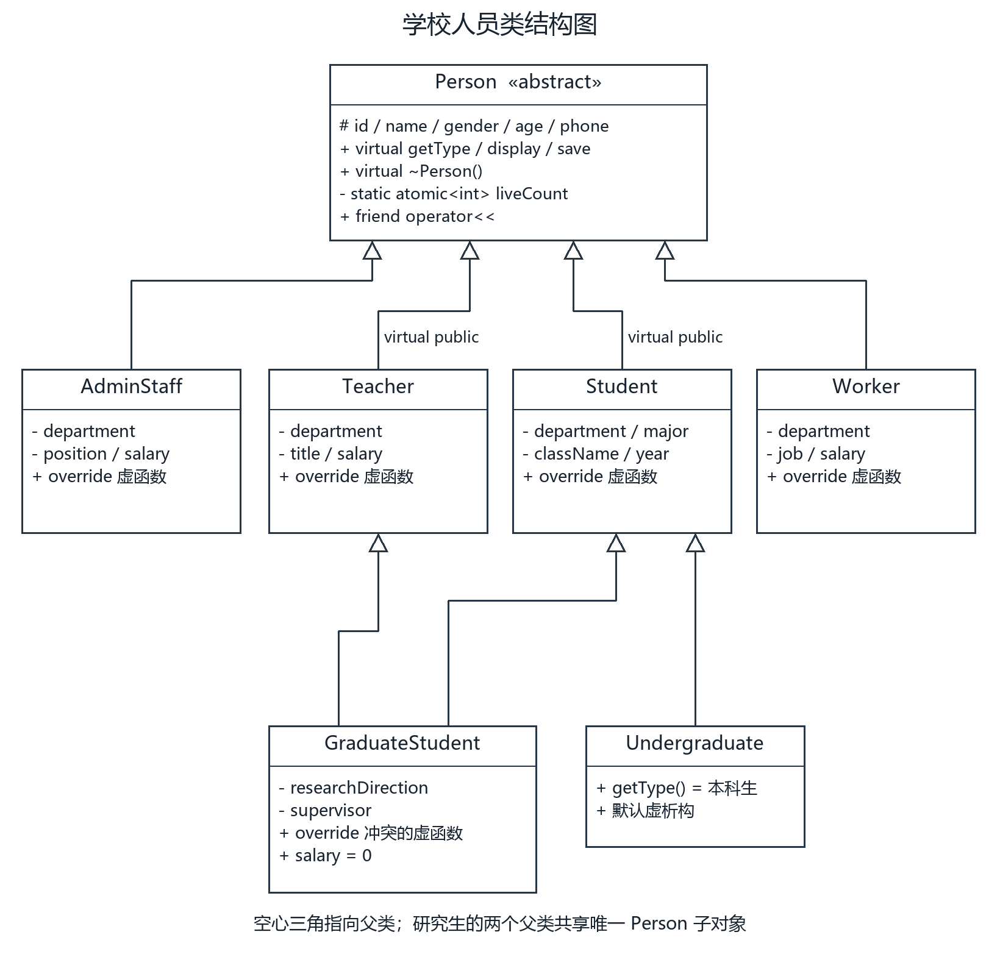
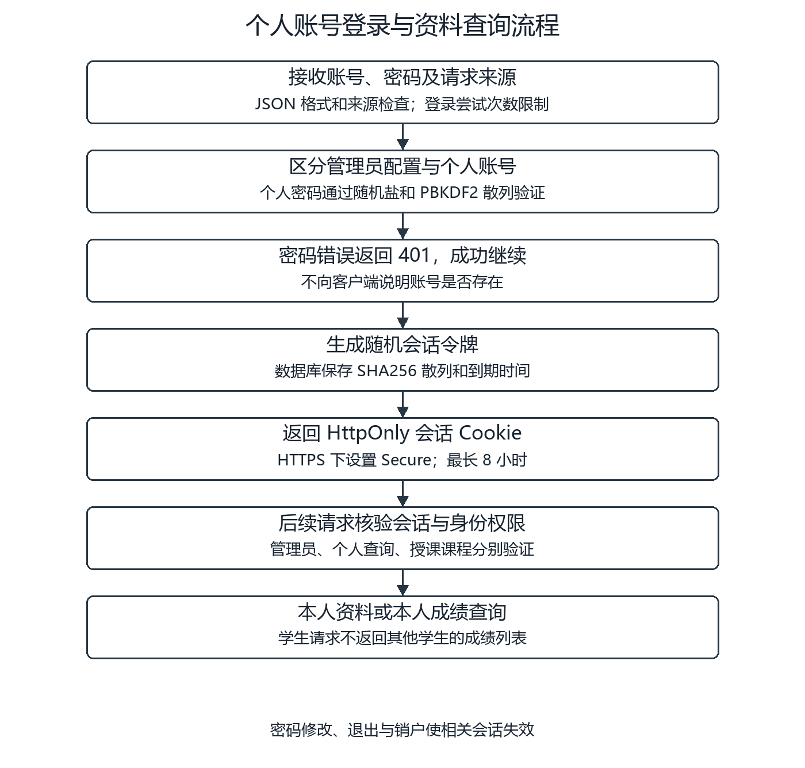
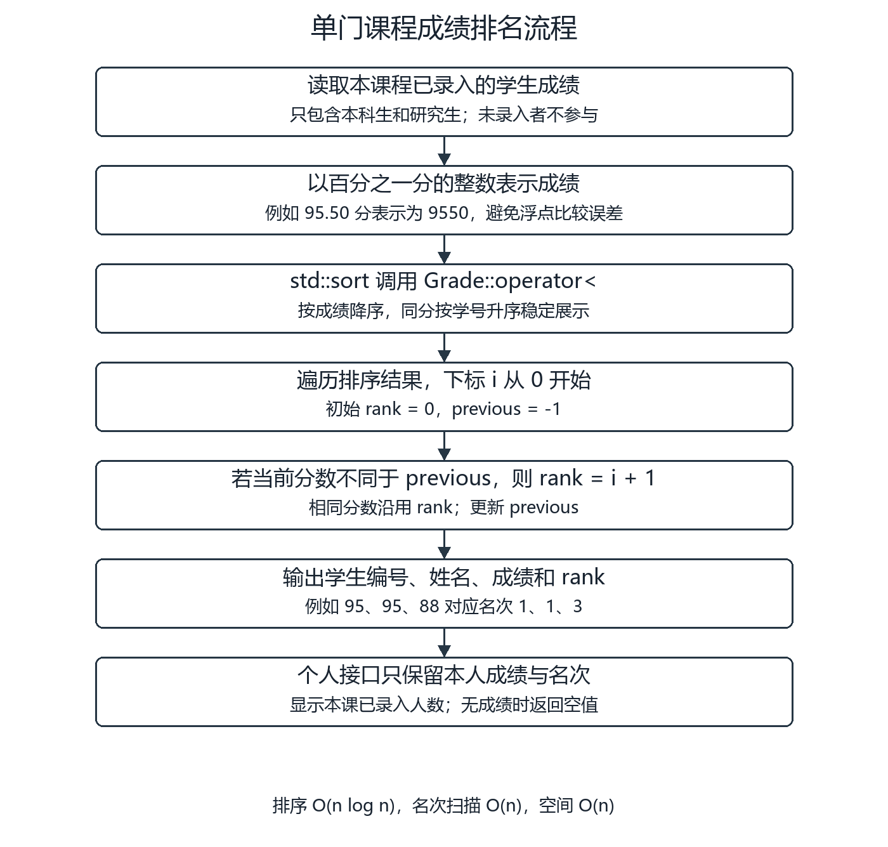
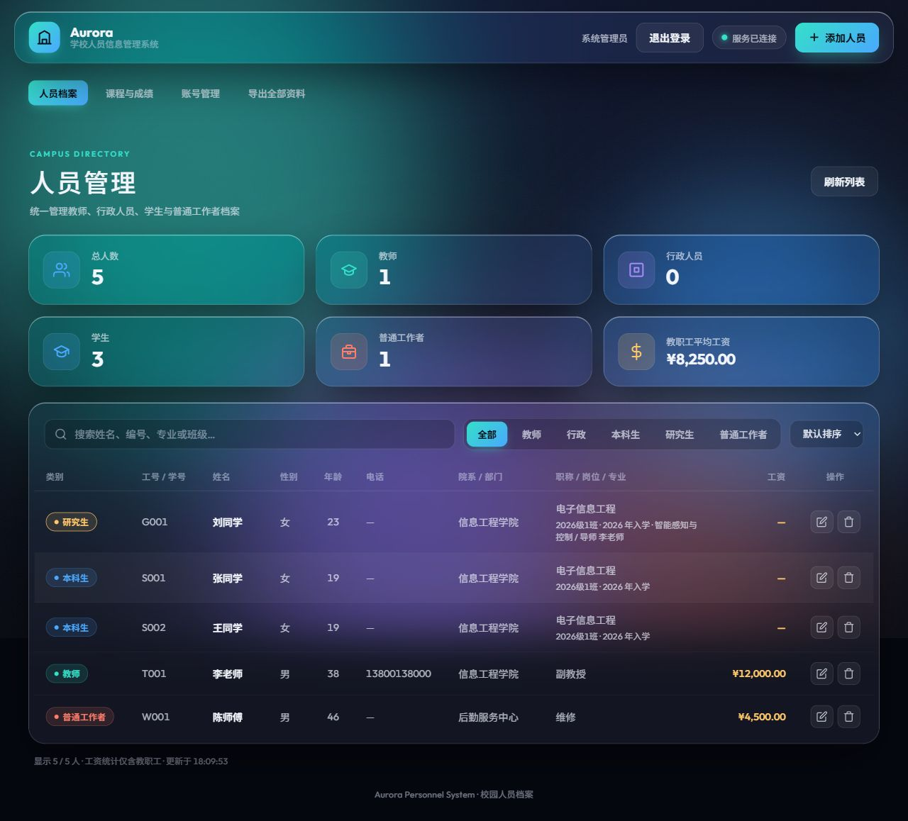
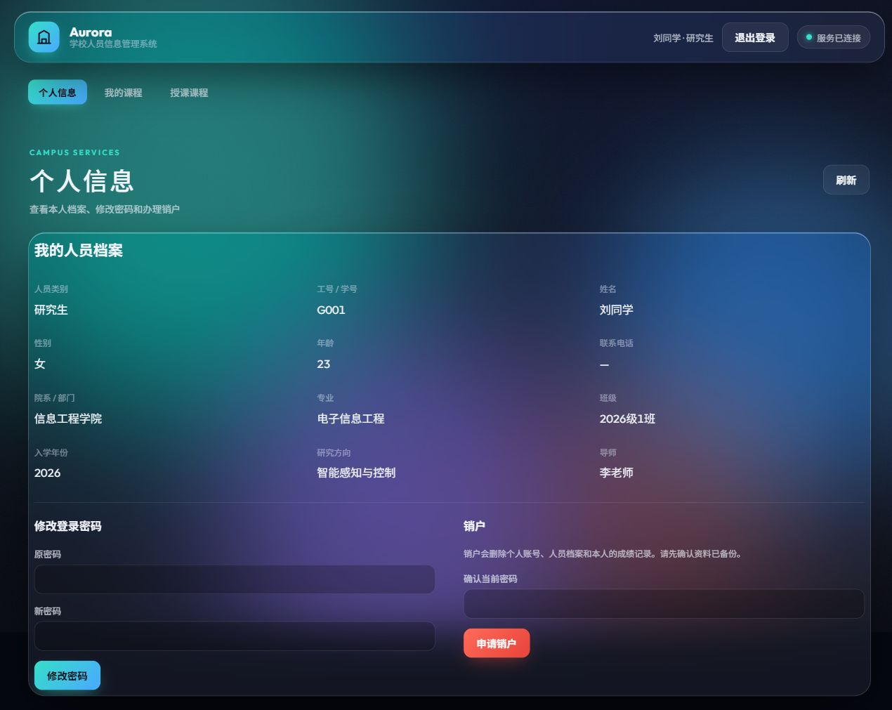
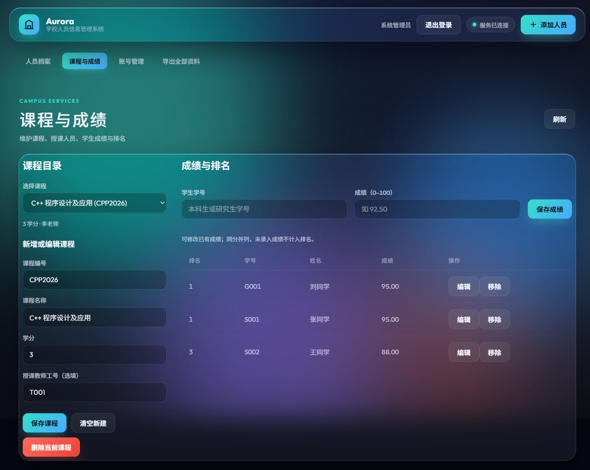
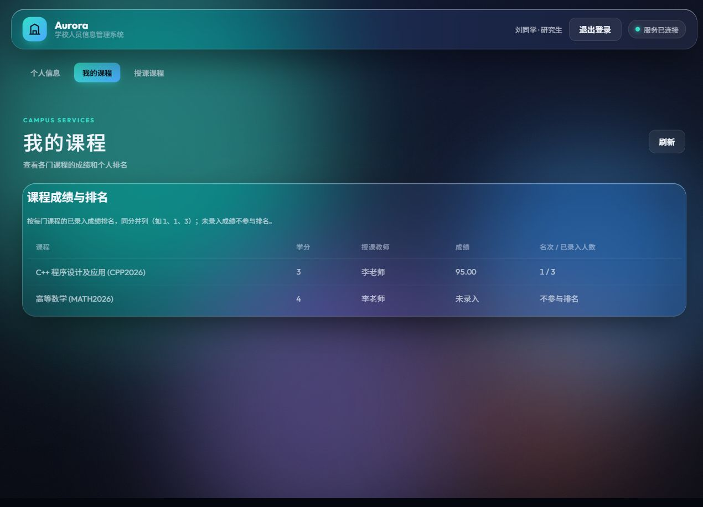
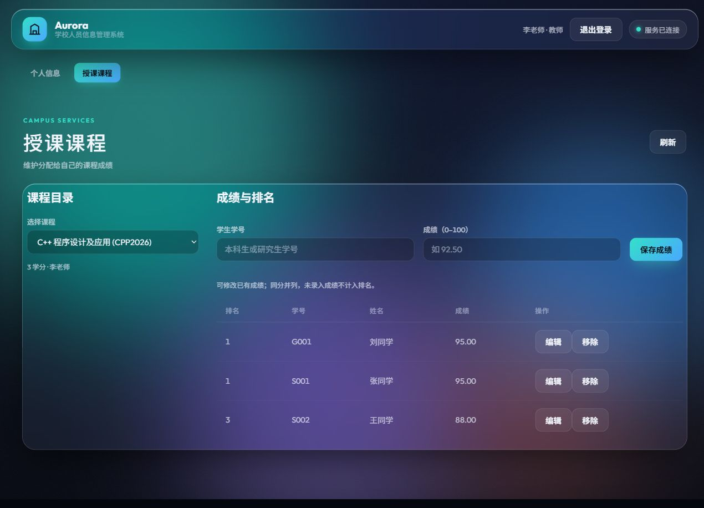

# 学校人员信息管理系统

本科课程设计报告正文材料。课程：C++程序设计及应用。材料整理日期：2026 年 10 月 11 日。Word 模板的排版验收状态见 [排版说明](report-format.md)；本文件包含待填入模板的内容。

## 封面资料

| 项目 | 内容 |
| --- | --- |
| 课程名称 | C++程序设计及应用 |
| 设计题目 | 学校人员信息管理系统 |
| 专业班级 | |
| 学生姓名 | |
| 学生学号 | |
| 指导教师 | |
| 学生邮箱 | |

个人信息按本人要求暂留空，日期以实际提交时间为准。

## 课程设计任务书

学校教师、学生及校园工作者的档案具有共同的编号、姓名、性别和年龄，也具有各自的专属信息。分散登记容易造成重复编号、资料遗漏和课程成绩查询不便。本设计使用 C++ 的类、继承和多态统一表达人员信息，并通过浏览器界面完成录入与个人查询。系统保存个人账号、人员、课程和成绩，支持重启后继续使用，以满足题目规定的管理和文件持久化要求。

基本功能指标：

1. 建立人员抽象基类，保存编号、姓名、性别、年龄等公共信息，保证工号和学号全校唯一。
2. 实现个人开户、登录、退出及本人确认销户，登录后查看本人相关资料。
3. 建立教师类，记录职称和部门，支持输入、保存及教师本人查询。
4. 建立学生类，明确本科生和研究生，记录学院、专业、班级、入学年份。
5. 学生可查看各门课、成绩和在本课程已录入成绩学生中的名次；同分并列，未录入不排名。
6. 研究生类同时由教师和学生派生，增加研究方向和导师，支持输入、保存和本人查看。
7. 将全部业务信息保存到 SQLite 文件，并使用文件流输出和回读完整资料。
8. 检查非法输入、重复编号及越权访问，对失败给出明确提示。

扩展功能：行政人员和普通工作者管理；人员搜索、分类、排序和工资统计；教师维护被分配课程的成绩；个人密码修改和账号关闭；HTTPS、数据库备份与服务器服务管理。

交稿形式：打印稿、软件及电子报告。指导教师签名、学生签名和日期留空，按实际情况填写。模板评分表保留供教师评分，本文不预填分数。

## 一 设计任务

本系统选择题目中的“学校人员信息管理系统”，采用可视化方式实现。C++17 负责人员模型、业务校验、账号认证、课程成绩、排名、HTTP 服务和数据库访问，浏览器负责页面呈现与操作。SQLite 在 C++ 进程中运行，数据写入文件，不依赖额外数据库服务。

管理员管理全校人员、已有人员的个人账号、课程和成绩。个人账号绑定一个工号或学号，教师、行政人员、普通工作者可查看自己的档案；本科生和研究生可查看自己的课程成绩和名次。教师与研究生只能维护管理员分配给自己的课程，学生接口不会返回其他学生的成绩明细。

研究生按题目要求同时继承教师和学生。系统将研究生作为学生统计，不设置工资；教师父类为其提供授课身份和接口能力。研究方向与导师是研究生必填字段，不能用一个类别标签替代真实的多重继承。

课程目录对学生统一展示，尚未输入的成绩显示“未录入”。本版本没有选课或学期管理模块，排名范围明确为该课程已录入有效成绩的本科生与研究生。用户界面使用确认对话框说明删除影响，个人销户还需验证当前密码。

### 数据关系与存储

| 文件或表 | 保存内容与关系 |
| --- | --- |
| school.db / people | 五类人员及研究生方向、导师；编号为唯一主键 |
| accounts | 绑定人员编号，保存随机盐、密码散列和迭代次数 |
| sessions | 会话令牌散列、个人编号、管理员标记、到期时间 |
| courses | 课程编号、名称、学分、授课人员 |
| grades | 课程与学号组成联合主键，保存百分之一分的整数成绩 |
| school.db.export.json | 文件流导出的全部人员、账号、课程和成绩，不含明文密码或会话令牌 |
| school_data.txt | 控制台人员文本记录；与 Web 数据独立 |

人员编号变更通过外键同步到账号、会话、授课关系及成绩。删除人员会删除个人账号和成绩，并解除其授课关系。关闭账号保留人员和成绩；个人销户则删除本人相关业务记录。数据库备份用于完整恢复，JSON 文件用于查阅及文件流演示，当前没有 JSON 导入功能。

## 二 类结构图



**图 1 学校人员类结构图**

Person 是抽象基类，公共资料为 protected，计数成员为 private，操作接口为 public。Teacher 与 Student 的专属字段为 private，二者均以 virtual public 方式继承 Person。GraduateStudent 继承 Teacher 和 Student；Undergraduate 继承 Student。AdminStaff、Worker 直接继承 Person。空心三角指向父类，图中的 virtual public 标识虚继承。

如果两个父类普通继承 Person，研究生对象会含两份身份字段。虚继承使其共享唯一 Person，最派生的 GraduateStudent 构造函数负责初始化这个子对象；它还重写 getType、getSalary、input、display、displayRow 和 save，明确冲突的最终实现。C++ 模型测试将研究生分别转换到两个父类，再转换为 Person，验证两个指针相等。

Web 层由 web_server、routes、person_codec 处理协议与资料转换，Service 校验人员，Academy 处理账号、课程和成绩，Dao 访问数据库。Academy 是 Dao 的友元，需要在同一连接和锁保护下完成“人员加账号”的原子事务，避免开户失败后留下半条业务记录。

### 登录与成绩排名算法



**图 2 个人账号登录与资料查询流程**

个人密码经随机盐与 PBKDF2-HMAC-SHA256 验证，使用 600000 次迭代。随机会话令牌只向浏览器返回一次，数据库保存其 SHA256 散列。请求到达后先验证会话，再按管理员、本人或授课关系检查权限；网页隐藏按钮之外，后端也独立判断权限。



**图 3 单门课程成绩排名流程**

成绩最多两位小数，转为整数保存，例如 95.50 表示为 9550。Grade 的比较运算符定义成绩降序、同分学号升序。排序后遍历，遇到不同分数时将名次设为下标加一；同分沿用上一名次，因此 95、95、88 的名次是 1、1、3。排序复杂度 O(n log n)，扫描 O(n)，其中 n 是该课程已录入成绩的学生数。

## 三 代码实现

以下为自编关键代码摘录，省略与说明无关的字段及实现；完整源码随项目提交，第三方库不作为个人代码展示。

### 人员抽象基类与知识点

```cpp
class Person {
    static std::atomic<int> liveCount;  // 所有派生对象共用计数
protected:
    std::string id, name, gender, phone;
    int age;
public:
    Person(std::string id = "", std::string name = "",
           std::string gender = "", int age = 0,
           std::string phone = "");
    virtual ~Person();                 // 基类指针安全释放派生对象
    static int getLiveCount() { return liveCount.load(); }
    friend std::ostream& operator<<(std::ostream&, const Person&);
    virtual std::string getType() const = 0;
    virtual void save(std::ostream&) const = 0;
};
```

默认形参使不同录入场景复用构造函数；const 引用减少不必要复制。类内访问器体现内联，虚析构确保通过 Person 指针销毁完整对象。liveCount 使用原子类型，避免 Web 并发处理时计数竞争。

```cpp
std::ostream& operator<<(std::ostream& os, const Person& person) {
    return os << person.getType() << " " << person.id
              << " " << person.name << " " << person.gender
              << " " << person.age << "岁";
}
```

输出运算符是实际使用的友元函数，可以读取 protected 字段，同时调用虚函数得到正确类别。控制台删除确认等公共资料输出使用该运算符。

### 虚继承与研究生构造

```cpp
class Teacher : virtual public Person { /* 教师专属字段 */ };
class Student : virtual public Person { /* 学生专属字段 */ };
class GraduateStudent : public Teacher, public Student {
    std::string researchDirection;
    std::string supervisor;
public:
    ~GraduateStudent() override = default;
    std::string getType() const override { return "研究生"; }
    double getSalary() const override { return 0; }
    // 其余冲突的虚函数也分别重写
};
```

```cpp
GraduateStudent::GraduateStudent(
    string id, string name, string gender, int age, string phone,
    string department, string major, string className,
    int admissionYear, string researchDirection, string supervisor)
    : Person(id, name, gender, age, phone), // 最派生类初始化虚基类
      Teacher(id, name, gender, age, phone, department, "研究助教", 0),
      Student(id, name, gender, age, phone, department,
              major, className, admissionYear),
      researchDirection(researchDirection), supervisor(supervisor) {}
```

教师与学生拥有不同的部门访问器，研究生明确使用 Student 的学院信息；构造时两父类接收同一部门。JSON 转换先识别研究生，再识别教师，避免将研究生误序列化成教师而丢失导师等字段。

### 成绩比较和并列排名

```cpp
bool Grade::operator<(const Grade& other) const {
    // “小于”表示优先排列，故成绩更高者先输出
    return hundredths != other.hundredths
        ? hundredths > other.hundredths
        : studentId < other.studentId;
}
// 排序与名次扫描，values 为 vector<Grade>
std::sort(values.begin(), values.end());
int rank = 0, previous = -1;
for (size_t i = 0; i < values.size(); ++i) {
    const auto& value = values[i];
    if (value.getHundredths() != previous) {
        rank = static_cast<int>(i) + 1;
        previous = value.getHundredths();
    }
    // 将当前学生、成绩和 rank 加入结果
}
```

比较函数提供确定的顺序，不会给相同分数产生不一致的排序条件。名次只比较整数分数，学号仅决定同分的展示顺序；未录入成绩不加入 values。

### 开户事务与密码保存

开户先校验并标准化人员，生成随机盐和密码散列，再获得 Dao 的锁并开始 SQLite 事务。事务内写入人员和绑定账号，全部成功后提交；异常由 RAII 事务对象回滚。已有人员开户先验证编号存在，重复账号返回冲突错误。

```cpp
// 验证个人密码的核心步骤；盐、散列和迭代数来自 accounts
bool matched = schoolcrypto::equal(
    hash, schoolcrypto::derive(password, salt, iterations));
return found && matched;  // 账号不存在时也执行派生计算
```

Windows 使用 BCrypt，Ubuntu 使用 OpenSSL 实现相同的 PBKDF2。测试使用 Python hashlib 验证存储结果互通，避免将平台封装当作未经验证的自制算法。会话、Cookie、来源检查和按课程授课关系判断都在 C++ 后端执行。

### 文件流保存与回读

```cpp
{
    std::ofstream stream(temporary, std::ios::binary);
    if (!stream) throw std::runtime_error("无法创建导出文件");
    stream << result.dump(2);          // 全部业务表的事务快照
    stream.close();
    if (!stream) throw std::runtime_error("导出文件写入失败");
}
std::filesystem::rename(temporary, filename);
std::ifstream input(filename, std::ios::binary);
nlohmann::json verified;
input >> verified;
if (verified != result)
    throw std::runtime_error("导出文件校验失败");
```

临时文件写完后替换目标，并回读比较。实现还设置仅所有者读写权限，并串行处理同一路径导出；Windows 在替换前移除已有目标，相关分支在完整源码中。导出账号盐和散列，不导出明文密码、管理员环境配置或会话令牌。

### 其他 C++ 知识点应用

| 知识点 | 用途 |
| --- | --- |
| 引用与常量 | Dao& 共享数据库实例，const Person& 统一校验，SessionSeconds 为会话时长常量 |
| vector 与动态对象 | 控制台 vector<Person*> 管理派生对象，排名 vector<Grade>；后端 unique_ptr 负责对象生命期 |
| 构造、析构与 RAII | 人员初始化/计数，查询句柄释放，事务回滚，拥有的人员指针统一释放 |
| 丰富类型及访问控制 | string、int、double、bool、枚举；private 专有字段、protected 共同身份、public 业务接口 |
| 多态与动态识别 | 基类指针调用显示/保存，dynamic_cast 区分研究生、本科生和教职工 |

## 四 调试与运行结果图

Windows 使用 MinGW GCC 15.2，C++17，开启 -Wall -Wextra -Wpedantic，最终编译无警告。新增核心功能通过独立测试库验证，界面截图中的姓名和资料均为测试数据，未写入正式人员数据库。


**图 4 个人账号与管理员登录页面**

浏览器显示表单登录，支持开户。已有档案不应重复注册，由管理员开通绑定账号。未认证的人员资料 API 返回 401，静态登录页面正常打开。



**图 5 管理员人员档案与分类统计**

列表明确标记本科生、研究生、教师及普通工作者，研究生条目包含方向和导师。测试库有三名学生、一名教师、一名工作者，教师与工作者工资平均值为 (12000 + 4500) / 2 = 8250，验证学生未计入工资统计。行政人员功能由接口测试覆盖。



**图 6 研究生本人资料及研究方向导师**

研究生登录后可以查看唯一学号和本人研究方向、导师，导航同时显示“我的课程”和“授课课程”。本人信息查询不显示管理员全校人员列表。



**图 7 管理员课程维护与成绩排名**

C++ 课程有 95、95、88 三条成绩，名次为 1、1、3。浏览器将 S001 改为 96 后立即显示其第 1、原 95 分第 2、88 分第 3；恢复 95 后重新成为 1、1、3。截图为恢复后的结果，说明排名根据保存的当前成绩计算。



**图 8 学生查看本人成绩与个人名次**

G001 仅看到自己在 C++ 课程的 95 分、1/3 名次和高等数学的“未录入／不参与排名”。页面没有其他学生的成绩明细；直接访问课程全员成绩 API 也会被后端拒绝。



**图 9 教师维护本人授课课程成绩**

教师登录可查看本人职称、部门及工资，并维护被分配课程的成绩。修改课程目录与人员档案仍需管理员权限，未分配课程的成绩访问返回 403。

### 自动化验证与结果分析

| 验证 | 最终结果及说明 |
| --- | --- |
| 16 组原接口回归 | 通过；人员增删改查、编号/类别变更、校验、并发冲突、Unicode、认证、锁/损坏恢复、旧库迁移 |
| 7 组作业新增验收 | 通过；注册/开户、研究生、本人范围、课程权限、精确成绩/并列名次、外键关联、文件保存、密码互通、销户和会话 |
| 控制台文件验证 | 通过；本科生、工作者及研究生文本保存/重新加载，方向导师保持，工资排除学生 |
| C++ 模型测试 | 通过；两个父类共享 Person、类别多态、静态计数/析构、友元输出和 Grade 比较 |
| 浏览器验证 | 通过；登录、研究生编辑回填、个人资料、学生课程、教师授课和管理员修改成绩，错误日志为空 |
| 服务重启 | 测试通过；人员、账号、课程、成绩及有效个人会话保留，旧管理员会话需重新认证 |
| 服务器发布 | Ubuntu 模型、16 组接口、7 组新增验收及控制台测试通过；公网认证、权限、排名、导出与重启保存通过，原有 1 条记录保留且测试资料清理，详见 deploy/README.md |

测试复现命令见项目 README。自动化测试启动临时端口并使用临时目录，不接触已有 school.db。SQLite 备份额外执行完整性检查，正式服务器切换前后对旧记录逐字段核对，以区分测试成功与实际迁移成功。

调试中发现 Windows 头文件的包含顺序会影响 BCrypt 类型声明，标准命名空间整体引入也会与 Windows SDK 的 byte 冲突。最终将 Windows 类型声明置于 BCrypt 之前，并使网络头文件先于旧业务头文件；Person 头文件只引入使用的标准名称。数据库连接、查询和文件句柄须及时释放，否则 Windows 临时目录清理会失败。上述问题修复后重新运行了全部相关测试。公网重启检查中遇到 Nginx 在后端就绪前短暂返回 502，验收脚本调整为等待健康恢复后再判断，最终通过。

## 五 总结与体会

本设计实现学校人员的统一档案管理、个人账号、课程成绩查询和排名，完成了研究生的多重继承及研究方向、导师保存。系统使用 C++17 处理业务与存储，Web 界面连接真实后端，SQLite 文件持久化保证重启后可继续使用。行政人员、普通工作者、统计、授课权限及服务器部署作为扩展保留。

类结构设计的关键是区分身份共享和专属资料：虚继承解决研究生的公共人员重复问题，虚函数决定其最终行为，明确的访问器解决部门名称冲突。成绩排名的关键是先定义范围和并列规则，再使用整数表示成绩；只对当前课程的有效记录排序，使未录入、同分和修改后的结果一致。

工程实现中，事务保证人员与账号一起开户，外键维护编号和类别变化后的关联，RAII 释放资源；权限在后端验证，使个人页面的隐藏按钮不会成为唯一访问控制。静态计数、友元函数、友元类、比较运算符和文件流均用于实际功能，避免仅为展示语法而增加无用途代码。

仍可完善的内容包括学期和选课关系、批量成绩导入、管理员审计、个人资料变更申请和 JSON 备份导入。现有 JSON 导出不能直接恢复数据库，控制台也不与 Web 自动同步。这些属于后续扩展，不影响本次六项基本业务验收。个人学习体会可由本人在理解代码并完成答辩准备后补充；本文不虚构个人经历。

## 参考文献

[1] ISO/IEC JTC1/SC22/WG21. Working Draft Standard for Programming Language C++ N4950[EB/OL]. 2023[2026-10-11]. https://www.open-std.org/jtc1/sc22/wg21/docs/papers/2023/n4950.pdf.

[2] LOHMANN N. JSON for Modern C++ 3.12.0 Release Notes[EB/OL]. 2025-04-11[2026-10-11]. https://github.com/nlohmann/json/releases/tag/v3.12.0.

[3] SQLite. Release History SQLite 3.51.3[EB/OL]. 2026-03-13[2026-10-11]. https://www.sqlite.org/changes.html.

[4] YHIROSE. cpp-httplib v0.60.1 Release Notes[EB/OL]. 2026-10-08[2026-10-11]. https://github.com/yhirose/cpp-httplib/releases/tag/v0.60.1.

[5] OpenSSL Project. OpenSSL 3.5 PKCS5_PBKDF2_HMAC Manual[EB/OL]. 2025[2026-10-11]. https://docs.openssl.org/3.5/man3/PKCS5_PBKDF2_HMAC/.

[6] OpenSSL Project. OpenSSL 3.5 Series Release Notes[EB/OL]. 2025[2026-10-11]. https://openssl-library.org/news/openssl-3.5-notes/.

以上均为近五年的标准工作草案、官方版本资料或技术文档。项目实际目标为 C++17，Ubuntu 使用系统 OpenSSL；引用资料用于继承、JSON、HTTP、数据库和密码派生原理，不声称所有运行库均采用文献版本。
